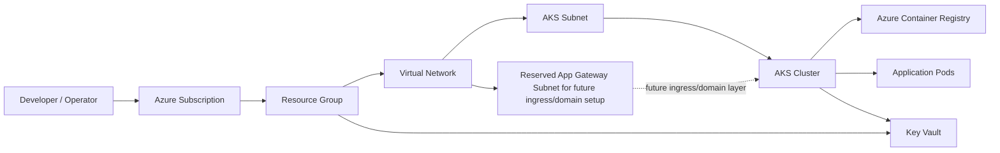

# Azure AKS Infrastructure

This project provisions a secure Azure Kubernetes Service (AKS) environment with networking, Azure Container Registry (ACR), and Key Vault using Terraform.

It is designed for a private, VNet-integrated setup where the AKS cluster and supporting Azure services are deployed in a secure network boundary. The DNS and database modules are currently not active in this root configuration, so the current environment focuses on AKS, ACR, networking, and Key Vault rather than PostgreSQL deployment.

## Architecture overview

The platform includes:

- Azure Resource Group
- Virtual Network with dedicated subnets for AKS and future ingress/domain use
- AKS cluster with managed identity and kubelet identity
- Azure Container Registry for application image storage
- Azure Key Vault for secrets and configuration
- A reserved application gateway subnet kept ready for future domain and ingress integration (not currently provisioned as an app gateway resource)

## Current Terraform configuration

This repository is configured to deploy the following environment based on the values in `terraform.tfvars`:
